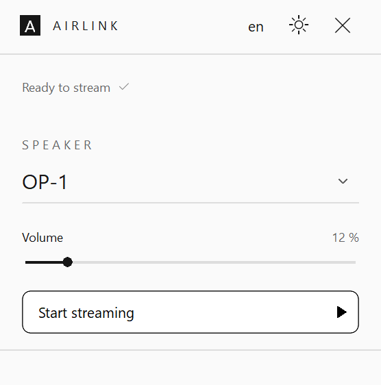
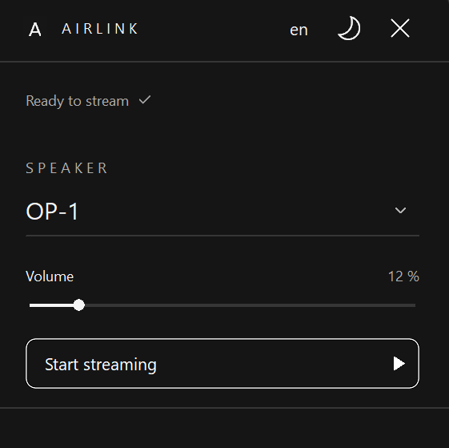

<h1 align="center">
   
</h1>
<h1 align="center">
AirLink
</h1>
<p align="center">Stream Windows system audio to an AirPlay speaker.</p>

<table align="center">
  <tr><th>Light mode</th><th>Dark mode</th></tr>
  <tr>
    <td></td>
    <td></td>
  </tr>
</table>

---

<p align="center">
  <a href="https://github.com/9cion/AirLink/releases/download/v0.1.0/AirLink-Setup.exe">
    <strong>⬇ Download for Windows</strong>
  </a>
  <br>
  Windows 10 22H2 / Windows 11 · x64
</p>

## Features

- Discover speakers, select one, start/stop streaming and adjust its volume.
- Mute local output while streaming and restore its previous mute state on stop.
- Automatically reconnect to the selected speaker after a connection loss.
- Keep streaming in the system tray when the window closes.
- Light/dark themes and English/German; preferences are saved locally.

## Install & use

Requires **Windows 10 22H2 x64 or Windows 11 x64**, an AirPlay speaker and a shared local network.

1. Run `AirLink-Setup.exe` from a built package (`dist/`) and open AirLink from the Start menu. Development builds are unsigned.
2. Select a speaker, choose a low volume and click **Start streaming**. Discovery runs automatically; **Search again** refreshes it.
3. Play audio on your PC. Click **Stop streaming** to return to local output.

## Build & test

Requires **Python 3.13 x64** and **Inno Setup 6** (`ISCC.exe` on PATH or under `.tools/Inno`). Bootstrap downloads the pinned Zig C compiler and installs transport build dependencies.

```powershell
powershell -NoProfile -ExecutionPolicy Bypass -File scripts/bootstrap.ps1
powershell -NoProfile -ExecutionPolicy Bypass -File scripts/build.ps1 -Installer
powershell -NoProfile -ExecutionPolicy Bypass -File scripts/test.ps1
```

Output: `dist/AirLink-Setup.exe`. GUI and WASAPI capture are native **C**; the bundled **Python/pyatv** helper handles AirPlay. Users do not need Python installed. Tests require an active Windows audio output; they do not play test tones.

## License

This project is licensed under the MIT License - see the LICENSE file for details.
